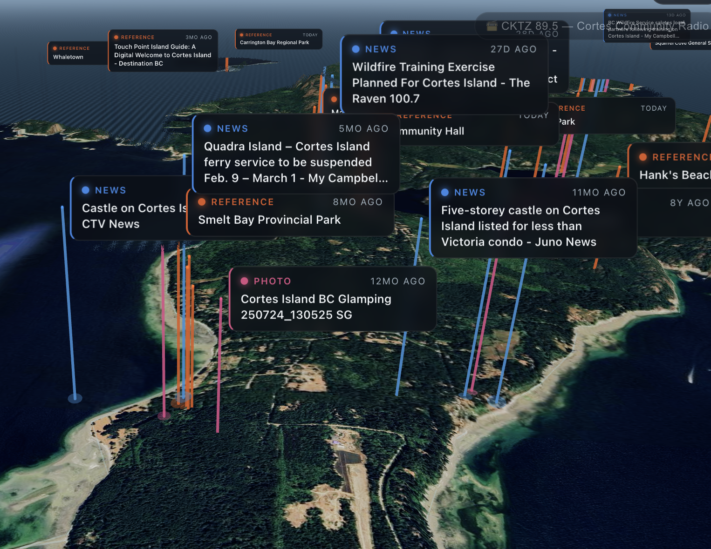

# island-portrait — a living portrait of an island
### currently deployed as **Salt Spring Island** → [saltspring.exe.xyz](https://saltspring.exe.xyz)

**This is the generalized fork of [cortes-island](https://github.com/orbitalfoundation/cortes-island).**
Everything place-specific lives in **`places/<id>.json`** — nothing else in the
codebase hardcodes a coordinate, a feed, a hashtag, a ferry or a coastline.
Point it at a new island by writing one profile:

```sh
cp places/saltspring.json places/mayne.json   # edit island/search/feeds/places/ferries
PLACE_ID=mayne node scripts/fetch-perimeter.mjs   # real OSM coastline (Nominatim fallback)
PLACE_ID=mayne npm start
```

A profile carries: `island` (name, centre, bbox) · `search` (quoted name,
match regex, hashtags, per-service query terms) · `feeds` (RSS with optional
filters) · `trust` (per-adapter scoring) · `osmIslands` (perimeter fetch) ·
`ferries` (route polyline + real sailing times) · `places` (gazetteer with
aliases) · `landAnchors` · `settlements` (night lights) · `islets` ·
`radioName`/`radioStream` · `tideStation`.

---

# original README


### ✨ **[Visit the live island → cortes.exe.xyz](https://cortes.exe.xyz)** ✨

[](https://cortes.exe.xyz)

A photorealistic 3D visualization of Cortes Island, BC, with a floating cloud
of geolocated information — news, wildlife observations, photos, community
posts, Indigenous and cultural landmarks — hovering over the places they
belong to. Real time-of-day, real weather, real ferry schedule, and the
island's actual community radio. A project of
[Orbital Foundation](https://github.com/orbitalfoundation).

## What it does

- **Aggregates** island-related media on a schedule from: Google News RSS,
  Cortes Currents, Campbell River Mirror, iNaturalist (geotagged wildlife
  observations with photos), Wikipedia geosearch (landmarks), Mastodon
  hashtags, Flickr, Reddit, and X (with `X_BEARER_TOKEN`).
- **Enriches** every item: geolocation via a Cortes gazetteer + optional
  Claude pass (place extraction, categorization, importance scoring 0..1,
  topic tags, relevance filtering).
- **Stores** items in Mongo (ECS-ish blobs riding an
  [`@orbitalfoundation/bus`](https://github.com/orbitalfoundation/orbital-bus));
  the socket.io gateway answers `{ query }` shapes and fans out live changes.
- **Renders** the island as Google Photorealistic 3D Tiles (Cesium ion asset
  2275207 via `3d-tiles-renderer` + three.js) with:
  - real time-of-day: computed sun & moon positions, stars, tone-mapped
    day/dusk/night (keys `[` `]` scrub time, `0` resets, `?t=HH:MM` pins it)
  - **carved-out island**: a mask shader discards everything that isn't
    Cortes and its satellite islands, leaving it afloat in open sea
    (`C` toggles, `?carve=0` keeps the surrounding world)
  - **vertical exaggeration** of the terrain (`?ex=2.2`, default 1.6)
  - **real weather** from Open-Meteo: overcast dims the light, wind drives
    the clouds and sea state, rain/snow fall as particles
    (`?wx=rain|snow|storm|clear` to preview)
  - an animated ocean shader with sun/moon glitter and storm seas,
    atmospheric haze, night settlement lights
  - drifting clouds, wheeling gulls, a humpback that surfaces in Sutil
    Channel, and the Heriot Bay–Whaletown ferry (with wake) crossing on
    (approximately) its real schedule
  - mobile-friendly: touch orbit, tap-to-focus bottom-sheet detail
  - **floating info cards** color-coded by category, tethered to their
    geolocation, height ∝ importance, opacity ∝ recency; hover to preview,
    click to focus (camera flies in, detail panel opens); legend chips filter
    categories

## Run it

```sh
npm install && npm --prefix client install
npm run build          # build the client → client/dist
cp .env.example .env   # add CESIUM_KEY (+ ANTHROPIC_API_KEY for enrichment)
npm start              # serves client + api + socket on :8000
npm run fetch          # one-shot aggregation (also runs on TICK_SECONDS)
```

Without mongo running it degrades to an in-memory store; `docker compose up`
brings mongo + app with data in a named volume that survives redeploys.

Dev loop: `npm start` (server on :8000) + `npm run dev` (vite on :5173,
proxies `/api` and `/socket.io`).

## Deploy (exe.dev)

The VM serves port 8000 at `https://<vm>.exe.xyz`. On the VM:

```sh
rsync -a --exclude node_modules --exclude .git . <vm>.exe.xyz:cortes/
ssh <vm>.exe.xyz 'cd cortes && docker compose up -d'
```

## Layout

```
server/            fastify + socket.io + bus; sources/, enrich, scheduler, store
client/            vite + three.js + 3d-tiles-renderer; world/, cards
docker-compose.yml mongo + app, bind-mounted repo
```
